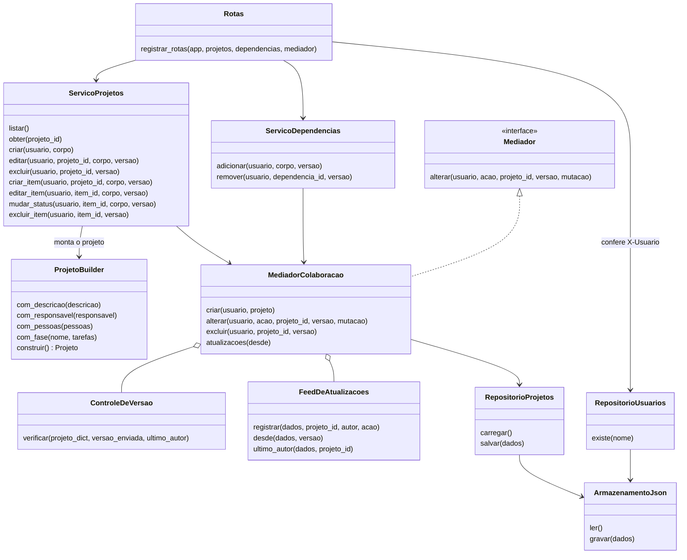
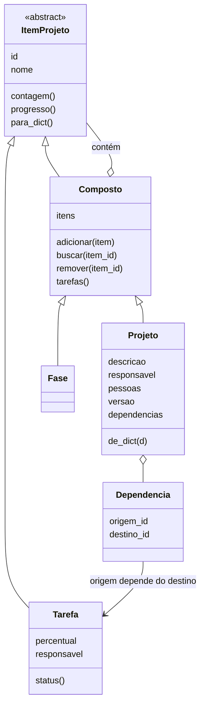
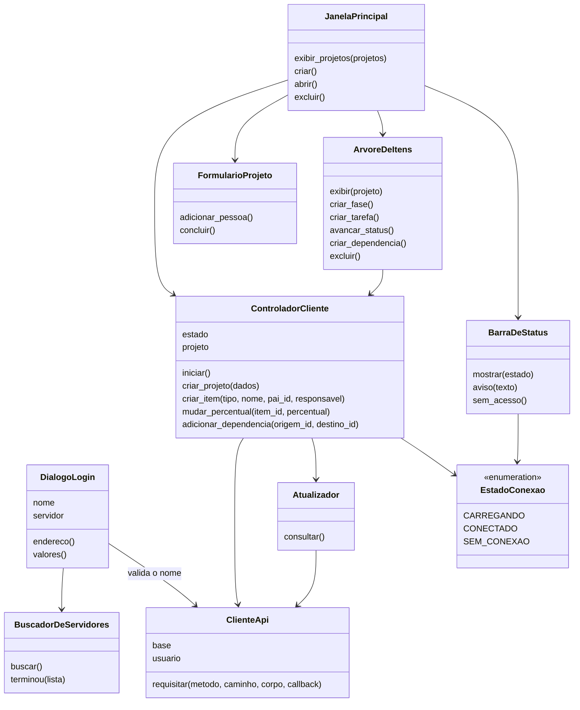

# Organizador de Projetos — Documentação

**Equipe 11:** Filipe Decio Demarco e Vinicius Rodrigues Cordeiro
**Disciplina:** Paradigmas de Programação — Turma CC5AN — Faculdade Impacta
**Professor:** Alex Torquato

## 1. Visão geral

O Organizador de Projetos permite que várias pessoas, em computadores diferentes, criem e acompanhem projetos organizados em hierarquia (projeto → fases → tarefas), com dependências entre tarefas e cálculo de progresso.

O sistema tem dois módulos independentes que se comunicam por HTTP com corpo JSON:

- **Servidor** (`modulo_servidor/`, Flask): regras de negócio, validações e persistência em arquivo JSON.
- **Cliente** (`modulo_cliente/`, PyQt6): interface gráfica; todas as telas vêm de arquivos do Qt Designer (`modulo_cliente/Ui/`).

Restrições atendidas: sem banco de dados, sem APIs de terceiros, sem serviços de nuvem e sem serviços de IA. Bibliotecas externas: apenas Flask e PyQt6.

## 2. Como executar

```
python -m pip install -r requirements.txt
python modulo_servidor/app.py      # na máquina do servidor
python modulo_cliente/main.py      # em cada máquina cliente
```

Ao abrir, o cliente procura o servidor na rede local e preenche o campo **Servidor** sozinho. Se não encontrar, o campo aceita o endereço digitado (`IP:5000`). Os nomes autorizados ficam em `dados/usuarios.json`.

Testes automatizados do servidor: `python -m unittest discover testes -v`.

## 3. Requisitos funcionais

| Id | Requisito |
|----|-----------|
| RF01 | Criar projeto com nome obrigatório e campos opcionais (descrição, responsável e pessoas envolvidas com cargo). |
| RF02 | Editar e excluir projeto. |
| RF03 | Criar, renomear e excluir fases e tarefas. Toda tarefa deve ficar dentro de uma fase. |
| RF04 | Registrar o progresso da tarefa em percentual de 0 a 100, de 10 em 10. O status é derivado: 0% pendente, 10–90% em andamento, 100% concluída. |
| RF05 | Registrar e remover dependências entre tarefas. |
| RF06 | Validar dependências: sem autodependência, sem referência a tarefa inexistente, sem duplicata e sem ciclos. |
| RF07 | Validar campos: nome obrigatório e percentual válido. Dado inválido é recusado e nada é gravado. |
| RF08 | Calcular e exibir o progresso: a tarefa mostra seu percentual; fase e projeto mostram a média das tarefas contidas. |
| RF09 | Persistir os dados em arquivo JSON e recarregá-los ao reiniciar o servidor. |
| RF10 | Mostrar aos demais usuários, sem reiniciar o cliente, as alterações feitas por um usuário. |
| RF11 | Detectar conflito de edição por número de versão, informar quem alterou e manter a primeira alteração. |
| RF12 | Indicar o estado da conexão: carregando servidor, conectado ou sem conexão com servidor. |
| RF13 | Iniciar servidor e cliente por comandos separados. |
| RF14 | Identificar o usuário pelo nome informado ao abrir o cliente, conferido em `dados/usuarios.json`, e registrar quem fez cada alteração. |
| RF15 | Descobrir o servidor automaticamente na rede local e preencher o campo Servidor. |
| RF16 | Atribuir um responsável a cada tarefa, escolhido entre as pessoas do projeto, e consultar as pessoas do projeto. |

## 4. Requisitos não funcionais

| Id | Requisito |
|----|-----------|
| RNF01 | Tecnologia: Python, Flask no servidor e PyQt6 no cliente; únicas bibliotecas externas: Flask e PyQt6. |
| RNF02 | Sem banco de dados, APIs de terceiros, serviços de nuvem ou serviços de IA. |
| RNF03 | Execução sem configuração: caminhos relativos, portas fixas (HTTP 5000, descoberta UDP 5001) e dados iniciais válidos no repositório. |
| RNF04 | O servidor fica disponível em até 10 segundos após iniciar. |
| RNF05 | Tempo de resposta curto: meta de até 1 segundo nas operações comuns com o volume de teste. |
| RNF06 | Transações (ACID): cada operação é gravada por inteiro ou não é gravada; em caso de erro o arquivo de dados permanece como estava. |
| RNF07 | Isolamento: as transações são confirmadas uma de cada vez; alteração baseada em versão desatualizada é recusada. |
| RNF08 | O cliente não trava enquanto aguarda o servidor (requisições assíncronas, com limite de 5 segundos por requisição). |
| RNF09 | Toda falha mostra mensagem compreensível, sem expor caminhos de arquivos ou detalhes internos. |
| RNF10 | Responsabilidades separadas em camadas; cada padrão de projeto isolado em classes próprias. |
| RNF11 | A lógica do servidor é testável sem a interface (25 testes automatizados). |
| RNF12 | Acesso restrito: requisição sem nome, ou com nome fora de `dados/usuarios.json`, é recusada com código 401. Limitação conhecida: não há senha nem HTTPS; quem souber um nome autorizado pode usá-lo. |
| RNF13 | Entrega em repositório público no GitHub com código-fonte e dados. |

## 5. Padrões de projeto

| Categoria | Padrão | Onde | Comportamento observável |
|-----------|--------|------|--------------------------|
| Criacional | **Builder** | `modulo_servidor/builder.py` (`ProjetoBuilder`) | Criar projeto só com o nome funciona; com campos opcionais, fases e tarefas iniciais também; com dado inválido nada é gravado e a resposta explica o motivo (422). |
| Estrutural | **Composite** | `modulo_servidor/modelo.py` (`ItemProjeto`, `Tarefa`, `Composto`, `Fase`, `Projeto`) | O progresso é pedido pela mesma operação em qualquer nível e muda em cadeia quando uma tarefa avança. |
| Comportamental | **Mediator** | `modulo_servidor/mediador.py` (`MediadorColaboracao`) | Ao salvar, a versão avança, o evento é registrado com o nome do autor e o outro usuário o vê na próxima consulta; salvar com versão antiga é recusado (409). |

## 6. API do servidor

Toda requisição, exceto `GET /saude`, leva o cabeçalho `X-Usuario` com o nome do usuário.

| Método e rota | Função |
|---------------|--------|
| `GET /saude` | Informa que o servidor está no ar. |
| `GET /projetos`, `POST /projetos` | Listar e criar projetos. |
| `GET /projetos/<id>`, `PUT /projetos/<id>`, `DELETE /projetos/<id>` | Consultar, editar e excluir um projeto. |
| `POST /projetos/<id>/itens` | Criar fase ou tarefa sob o projeto ou sob uma fase. |
| `PUT /itens/<id>`, `DELETE /itens/<id>` | Renomear (e trocar o responsável da tarefa) ou excluir. |
| `PUT /itens/<id>/status` | Definir o percentual (0 a 100, de 10 em 10) de uma tarefa. |
| `POST /dependencias`, `DELETE /dependencias/<id>` | Criar e remover dependências. |
| `GET /atualizacoes?desde=<versao>` | Alterações feitas por outros usuários desde a versão informada. |

Códigos de resposta: 200, 201 e 204 (sucesso); 400 (JSON malformado); 401 (usuário ausente ou não autorizado); 404 (não encontrado); 409 (conflito de versão); 422 (dados inválidos).

**Descoberta na rede:** o servidor escuta a porta UDP 5001. Quando recebe `ORGANIZADOR?`, responde com seu nome e a porta HTTP. O cliente envia essa pergunta em broadcast e lista quem responder.

## 7. Diagramas de classes

### 7.1 Servidor — camadas e colaboração (Builder e Mediator)



### 7.2 Servidor — modelo de dados (Composite)



### 7.3 Cliente



A interface aciona o controlador, que fala com o servidor pelo `ClienteApi`. O `Atualizador` consulta a cada 2 segundos as mudanças de outros usuários e avisa o controlador, que atualiza as telas.

## 8. Condições de aceitação

| Id | Cobre | Condição |
|----|-------|----------|
| CA01 | RF01, RF07 | Ao criar um projeto informando só o nome, ele aparece na lista e fica salvo no arquivo de dados. |
| CA02 | RF01, RF16 | Ao criar um projeto com descrição, responsável e pessoas com cargo, todos os campos aparecem ao reabrir. |
| CA03 | RF07, RNF06 | Criar projeto sem nome é recusado (422), o cliente mostra o motivo e o arquivo de dados não muda. |
| CA04 | RF03 | Ao criar fases e tarefas dentro delas, a hierarquia aparece na ordem criada. |
| CA05 | RF03 | Criar uma tarefa fora de uma fase é recusado (422): "Toda tarefa deve ficar dentro de uma fase". |
| CA06 | RF05 | Ao ligar a tarefa B como dependente da tarefa A, a dependência aparece na tarefa B. |
| CA07 | RF06 | Dependência de uma tarefa com ela mesma, que feche um ciclo, repetida ou para tarefa inexistente é recusada com mensagem e nada é gravado. |
| CA08 | RF04 | O botão "Avançar Status" sobe a tarefa de 10 em 10 pontos até 100%; ao passar de 100% volta a 0%. Percentual fora de 0–100 ou não múltiplo de 10 é recusado (422). |
| CA09 | RF08 | Dada uma fase com duas tarefas, uma em 100% e outra em 0%, a fase mostra 50% e o projeto é recalculado. |
| CA10 | RF09 | Ao reiniciar o servidor, projetos, fases, tarefas, percentuais e dependências continuam presentes. |
| CA11 | RF10 | Com dois clientes conectados, a alteração salva por A aparece para B sem reiniciar, em até 2 segundos. |
| CA12 | RF11 | Se A e B abriram a mesma versão e A salva primeiro, B recebe o aviso "O projeto foi alterado por A. Recarregue antes de salvar." e a alteração de A permanece. |
| CA13 | RNF06 | Se a gravação falhar, o arquivo de dados permanece como estava e o usuário recebe mensagem de erro. |
| CA14 | RF12, RNF08 | Com o servidor desligado, o cliente mostra "sem conexão com servidor" sem travar a janela. |
| CA15 | RF13, RF15 | Ao iniciar o servidor e abrir o cliente na mesma rede, o campo Servidor aparece preenchido como "Servidor" sem digitar endereço. Se não for encontrado, o endereço pode ser digitado. |
| CA16 | RF14, RNF12 | Um nome que não está em `dados/usuarios.json` é recusado com a mensagem "Usuário não identificado ou não autorizado", a janela de login continua aberta e nenhum caminho de arquivo é exibido. |
| CA17 | RF14 | As alterações aparecem para os demais usuários com o nome de quem as fez. |
| CA18 | RNF07 | Duas confirmações simultâneas são executadas uma depois da outra e nenhuma alteração se perde. |
| CA19 | RF16 | Ao criar ou editar uma tarefa, o responsável é escolhido entre as pessoas do projeto; o botão "Pessoas" lista o responsável do projeto e os envolvidos com cargo. |
| CA20 | Padrões | Cada padrão (seção 5) é demonstrado pelo comportamento descrito e é repetível na apresentação. |

## 9. Testes

- **Automatizados (servidor):** `python -m unittest discover testes -v` executa 25 testes cobrindo projetos, hierarquia, percentual, dependências, colaboração (persistência, versão, falha de gravação) e acesso (401).
- **Manuais (cliente):** roteiro de demonstração com dois clientes: criar projeto, fase e tarefa; avançar percentual; criar dependência e tentar um ciclo; editar o mesmo projeto em dois clientes para ver o conflito; derrubar e reiniciar o servidor.

| Cenário do plano de testes | Cobre |
|----------------------------|-------|
| T11.1 Criar projeto e hierarquia de tarefas | RF01, RF03, RF04, RF08, RF09; CA01, CA02, CA04, CA05, CA08, CA09, CA10; Builder e Composite |
| T11.2 Validar dependências e campos | RF05, RF06, RF07; CA03, CA06, CA07; Builder |
| T11.3 Colaboração e persistência | RF09, RF10, RF11, RNF06, RNF07; CA10, CA11, CA12, CA13, CA18; Mediator |
| T11.4 Composite e Mediator | RF08, RF10, RF11; CA09, CA11, CA12; Composite e Mediator |
| Inicialização, conexão e acesso | RF12, RF13, RF14, RF15; CA14, CA15, CA16, CA17 |

## 10. Limitações e riscos

- Identificação só por nome: não há senha nem HTTPS.
- A descoberta automática depende de a rede permitir broadcast UDP. Em redes que bloqueiam, o endereço é digitado no campo Servidor.
- O servidor precisa liberar as portas TCP 5000 e UDP 5001 no firewall da máquina onde roda.
- O desempenho foi medido apenas com o volume de dados de teste.